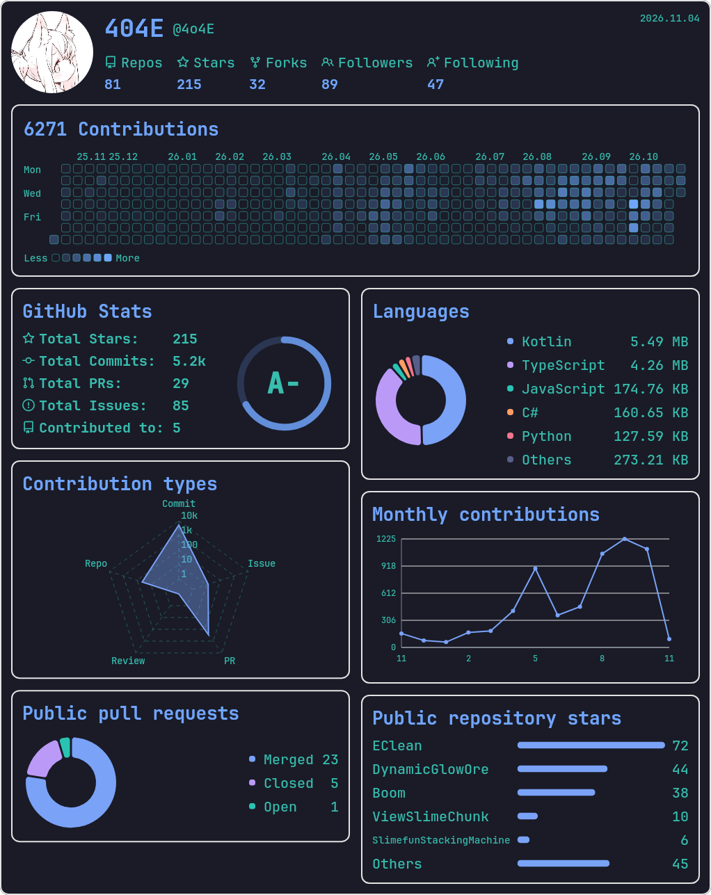
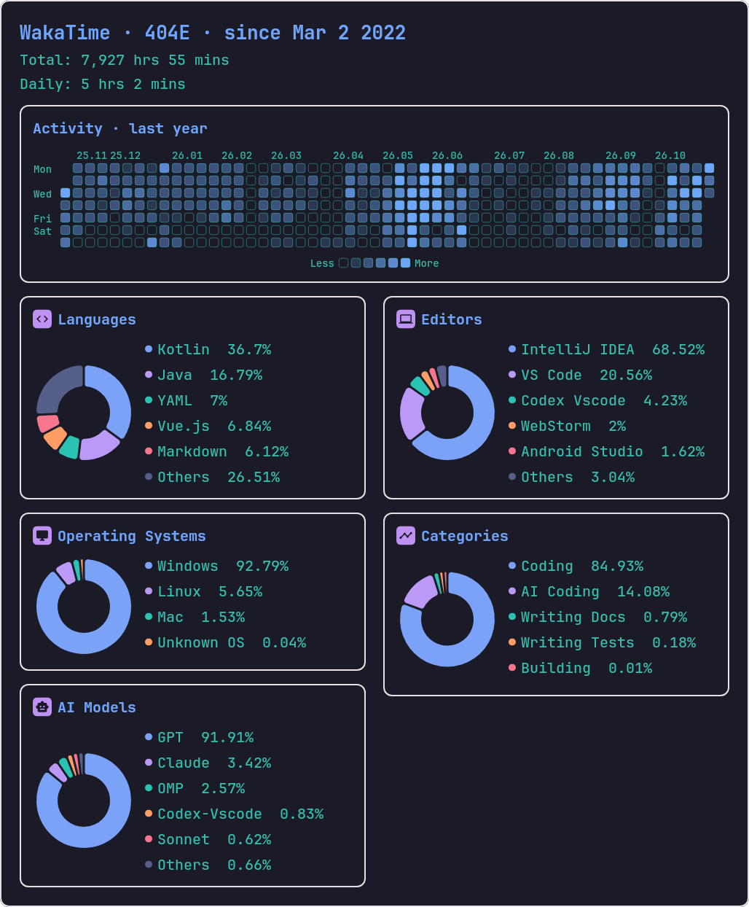
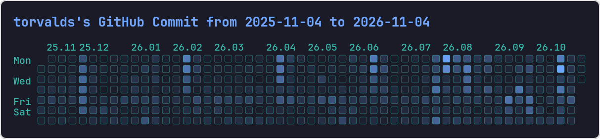
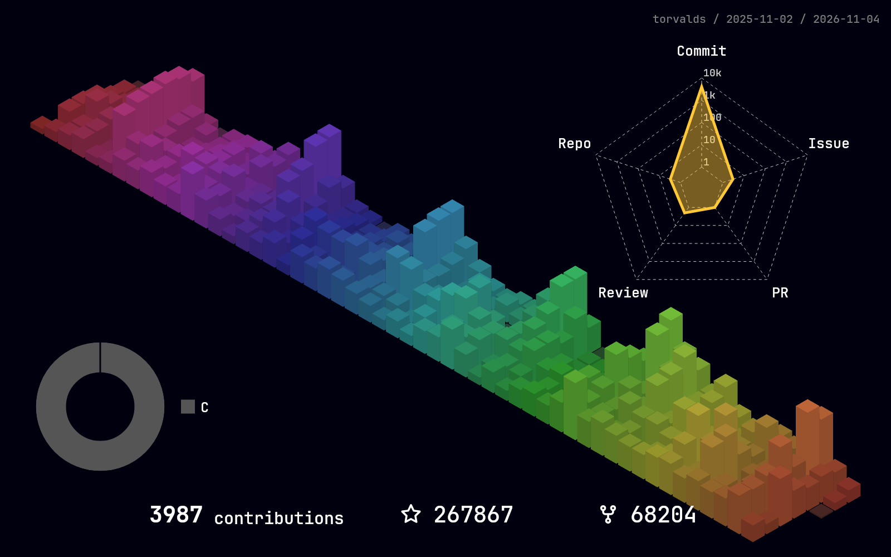
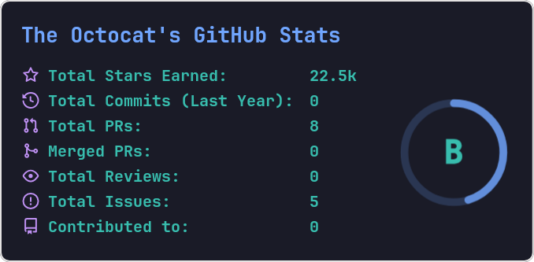
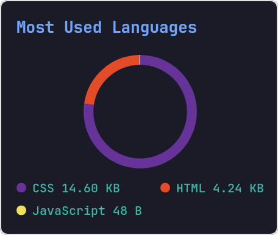
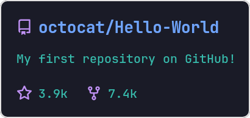

# statimg

将 GitHub、WakaTime 的开发者统计渲染为 PNG，适合 Bot、README 和不支持 SVG 的场景。数据在线获取，图片由服务端使用 Tavolo 绘制。

[](https://github.com/4o4E/statimg/releases/latest)
[](https://github.com/4o4E/statimg/releases)
[](LICENSE)

- **GitHub**：综合统计、贡献热力图、3D 贡献图、评级卡、语言卡和仓库卡。
- **WakaTime**：活动热力图及语言、编辑器、操作系统、活动分类、AI 模型等公开统计，合并为双列瀑布流图片。
- **HTTP API**：7 个 PNG 接口、2 个主题列表接口；[中文接口文档与全部示例图片](docs/http-api.md) · [OpenAPI 3.1](docs/openapi.yaml)。
- **Kotlin SDK**：[http-client 使用说明](http-client/README.md)。

## 效果预览

以下图片均由实际 HTTP 接口生成，不需要部署服务即可查看。点击接口名称查看参数和请求示例；点击图片可查看原图。

| [GitHub 综合统计](docs/http-api.md#github-综合统计图) | [WakaTime 综合统计](docs/http-api.md#wakatime-综合统计图) |
| --- | --- |
| [](docs/examples/github-dashboard.png) | [](docs/examples/wakatime-stats.png) |

### [GitHub 2D 贡献热力图](docs/http-api.md#github-2d-贡献热力图)

[](docs/examples/github-contribution.png)

### [GitHub 3D 贡献图](docs/http-api.md#github-3d-贡献图)

[](docs/examples/github-contribution3d.png)

| [GitHub 评级统计卡](docs/http-api.md#github-评级统计卡) | [GitHub 语言卡](docs/http-api.md#github-语言卡) |
| --- | --- |
| [](docs/examples/github-stats.png) | [](docs/examples/github-top-langs.png) |

### [GitHub 仓库卡](docs/http-api.md#github-仓库卡)

[](docs/examples/github-repo.png)

主题列表接口不返回图片：[GitHub 主题 JSON](docs/examples/github-themes.json) · [WakaTime 主题 JSON](docs/examples/wakatime-themes.json)。

## 运行前准备

发布的 `statimg-<版本>.jar` 包含 **Linux x64** 原生绘图运行时；镜像支持 **linux/amd64**。Jar 运行需要 **Java 17 或更高版本**。Windows 可使用 Docker Desktop／WSL；不要将 Linux 发布 Jar 当作跨平台 Jar 直接运行。

服务需要能访问 GitHub API、GitHub 用户主页／头像及 WakaTime API。服务本身不提供调用方认证，也不会主动缓存图片；需要公开部署时，请在反向代理层配置访问控制、限流和缓存。令牌仅保存在服务端，不要放在图片链接或请求参数中。

### GitHub 与 WakaTime 的数据权限

- **GitHub**：在服务端配置 `github_token`，令牌须能调用 GitHub GraphQL／REST API、读取目标公开数据。令牌可从 [GitHub Settings](https://github.com/settings/tokens) 创建，不需要为读取公开数据授予私有仓库权限。Dashboard 的热力图匿名读取目标用户主页，遵循其公开贡献设置；不会取得其他用户私有仓库的明细。
- **WakaTime**：不使用 Secret API Key、个人令牌或 App token。目标用户在 [WakaTime 公开设置](https://wakatime.com/settings/profile) 中开启需要展示的数据；分类统计采用用户设置的公开时间范围，不能由请求任意切换。活动日历使用其独立的公开年度数据。各类别权限独立，没有可展示的公开数据时返回 `403`，由调用方提示用户开启公开数据。

## 方式一：使用 Jar

以下命令在 Linux／WSL shell 中执行，以 `6.0.2` 为例。请从 [Releases](https://github.com/4o4E/statimg/releases) 选择实际版本，配置文件与 Jar 使用同一个版本。

### 1. 准备 Java、原生依赖与字体

Ubuntu／Debian 示例：

```sh
sudo apt-get update
sudo apt-get install -y openjdk-17-jre-headless libgl1 fontconfig curl unzip
java -version

mkdir -p statimg/font
cd statimg
curl -fL https://github.com/JetBrains/JetBrainsMono/releases/download/v2.304/JetBrainsMono-2.304.zip -o JetBrainsMono.zip
unzip -j JetBrainsMono.zip 'fonts/ttf/JetBrainsMono-Bold.ttf' 'fonts/ttf/JetBrainsMono-Medium.ttf' -d font
rm JetBrainsMono.zip
```

默认配置使用 `JetBrainsMono-Bold.ttf` 和 `JetBrainsMono-Medium.ttf`。可在配置中改为自己的字体路径；需要显示中文时应提供含中文字形的字体。字体文件优先从配置路径读取，再按文件名搜索本机字体目录。

### 2. 下载 Jar 与配置

继续在上一步的 `statimg` 目录执行：

```sh
VERSION=6.0.2
curl -fL "https://github.com/4o4E/statimg/releases/download/${VERSION}/statimg-${VERSION}.jar" -o statimg.jar
curl -fL "https://raw.githubusercontent.com/4o4E/statimg/${VERSION}/http-server/src/main/resources/config.yml" -o config.yml
```

编辑 `config.yml` 顶部的以下字段，**保留文件中的 `layout2d`、`themes2d`、`layout3d`、`themes3d`、`github3d` 等其余配置**：

```yaml
host: localhost
port: 2345
proxy: null
github_token: "替换为你的 GitHub 令牌"
```

- `host: localhost` 仅监听本机；需要由其他主机访问时改为合适的监听地址，例如 `0.0.0.0`。
- 无代理时使用 `proxy: null`；下载的默认配置带 SOCKS 代理，需要按实际环境修改。
- 使用代理时，将 `proxy` 改为下面的配置；`type` 支持 `http`、`socks`、`direct`。Jar 进程连接到这里填写的地址。
- 只调用 WakaTime 时，`github_token` 可保留下载配置中的非空占位值；不要删除该必填配置项，也不需要填写 WakaTime 密钥。

```yaml
proxy:
  type: http
  host: 127.0.0.1
  port: 7890
```

### 3. 启动并请求图片

```sh
java -jar statimg.jar
```

另开终端：

```sh
curl -f http://localhost:2345/github/themes
curl -fS --max-time 300 'http://localhost:2345/github/dashboard/4o4E?theme=tokyonight' -o github.png
curl -fS --max-time 300 'http://localhost:2345/wakatime/stats/404E?theme=tokyonight' -o wakatime.png
```

打开 `github.png`、`wakatime.png` 查看结果。使用 `Ctrl+C` 停止服务；后台常驻运行可交给 systemd 等现有进程管理工具。

配置、字体相对路径、日志和 `.lock` 文件都与**进程工作目录**有关。始终在准备好的目录启动，不要在同一个工作目录同时运行两个实例。未提供 `config.yml` 时会自动生成默认配置，但其中的令牌、代理与字体仍须按实际情况配置。

升级时先停止旧进程，备份私有配置，下载新 Jar 后在原目录重新启动；如新版本增加配置项，再对照该版本默认配置合并，不要直接覆盖已有令牌及主题配置。

## 方式二：使用 Docker Compose

镜像自带 Java、原生依赖和 JetBrains Mono 字体，无需在宿主机安装 Java。先安装 Docker Engine／Docker Desktop 及 Compose v2。

### 1. 下载 Compose 与环境变量示例

在独立的运行目录执行：

```sh
mkdir statimg-docker
cd statimg-docker
curl -fL https://raw.githubusercontent.com/4o4E/statimg/master/http-server-linux/docker-compose.yml -o docker-compose.yml
curl -fL https://raw.githubusercontent.com/4o4E/statimg/master/http-server-linux/.env.example -o .env
```

下载的 `.env` 示例默认配置了代理；不使用代理时，按下面的示例将 `PROXY_TYPE` 改为 `direct`。

编辑 `.env`：

```dotenv
SERVER_HOST=0.0.0.0
SERVER_PORT=80
PROXY_TYPE=direct
PROXY_HOST=127.0.0.1
PROXY_PORT=7890
GITHUB_TOKEN=替换为你的GitHub令牌
START_CMD="java -jar app.jar"
```

| 变量 | 说明 |
| --- | --- |
| `SERVER_HOST` | 容器内监听地址，使用 `0.0.0.0` 才能通过端口映射访问。 |
| `SERVER_PORT` | 容器内端口，默认 `80`，须与 Compose 端口映射右侧一致。 |
| `GITHUB_TOKEN` | 服务端 GitHub 令牌；只使用 WakaTime 时可保留示例中的非空占位值。 |
| `PROXY_TYPE` | 无代理填 `direct`；代理可使用 `http` 或 `socks`。 |
| `PROXY_HOST`／`PROXY_PORT` | 代理地址，`direct` 时不使用。启用代理时地址必须能从容器内访问；容器中的 `127.0.0.1` 不是宿主机。 |
| `START_CMD` | Java 启动命令；通常无需修改，需要时可添加 JVM 参数。 |

镜像入口通过这些变量填充配置，不会读取宿主机的 Jar 配置文件。不要把 `.env` 提交到仓库或在排查时打印令牌。

仓库的 Compose 示例使用 `ghcr.io/4o4e/statimg:latest`，默认映射宿主机 **80** 到容器 **80**。如果宿主机 80 已占用，或只允许本机访问，编辑 `docker-compose.yml`：

```yaml
ports:
  - "127.0.0.1:2345:80"
```

这时下面的请求地址改用 `http://localhost:2345`。如果沿用默认映射，则使用 `http://localhost`。

### 2. 启动与验证

```sh
docker compose pull
docker compose up -d
docker compose ps

curl -f http://localhost/github/themes
curl -fS --max-time 300 'http://localhost/github/dashboard/4o4E?theme=tokyonight' -o github.png
curl -fS --max-time 300 'http://localhost/wakatime/stats/404E?theme=tokyonight' -o wakatime.png
```

默认 Compose 将 `./font` 挂载到 `/app/font`，自定义字体可放入该目录；未提供自定义字体时会查找镜像内置的 JetBrains Mono。现有入口会调整 `/app` 中文件归属，Linux 宿主机的挂载目录可能变为 UID `1001` 所有，不要将无关目录挂载进去。镜像内置的版式、主题和自定义字体文件名应保持匹配。

仓库 Compose 将 `/dev/null` 挂载到容器的 `/app/logs`；文件日志实际写在工作目录的 `latest.log`，归档目录为 `logs/`，该挂载不等于禁用全部文件日志。可用 `docker compose logs --tail=100 statimg` 查看控制台日志；如需日志归档，先从 Compose 中移除该挂载并按运行环境配置持久化。

### 3. 更新与停止

```sh
# 更新latest镜像并重建本服务，保留.env和font目录。
docker compose pull
docker compose up -d

# 停止；需要同时删除本Compose容器与网络时使用down。
docker compose stop
docker compose down
```

修改 `.env` 后需要重新创建容器，例如 `docker compose up -d --force-recreate`。不要仅在已经替换过配置占位符的旧容器内手动重启 Java。

## HTTP API

完整参数、默认值、统计范围、状态码、curl 请求及真实图片见 **[中文 HTTP API 文档](docs/http-api.md)**。**[OpenAPI 3.1 文件](docs/openapi.yaml)** 可导入 Swagger Editor、Postman 等支持 OpenAPI 的工具；这是静态契约，服务本身不提供 Swagger UI 路由。

接口文档和示例图对应当前源码；发行包以对应版本为准。需要与当前源码完全一致时，按下文从源码构建。

| 方法 | 路径 | 返回 |
| --- | --- | --- |
| GET | `/github/dashboard/{username}` | GitHub 综合统计 PNG |
| GET | `/github/contribution/{username}/{end}` | GitHub 2D 贡献热力图 PNG |
| GET | `/github/contribution3d/{username}` | GitHub 3D 贡献图 PNG |
| GET | `/github/stats/{username}` | GitHub 评级统计卡 PNG |
| GET | `/github/top-langs/{username}` | GitHub 语言卡 PNG |
| GET | `/github/repo/{owner}/{repo}` | GitHub 仓库卡 PNG |
| GET | `/wakatime/stats/{username}` | WakaTime 综合统计 PNG |
| GET | `/github/themes` | 可用 2D 主题 JSON 数组 |
| GET | `/wakatime/themes` | 可用 2D 主题 JSON 数组 |

响应 `Content-Type` 为 `image/png` 时将响应体保存为图片；错误响应是文本，不要把失败响应当成 PNG。综合图会读取多个上游接口和完整分页，首次请求可能较慢；调用方应设置足够的超时，需要重复展示时自行缓存结果。

## 从源码构建

使用 JDK 17，在仓库根目录执行：

```sh
./gradlew :http-server-linux:shadowJar
```

产物为 `http-server-linux/build/libs/http-server-linux.jar`，仍按前述 Jar 流程准备配置和字体。Windows 原生包使用 `gradlew.bat :http-server-win:shadowJar`，产物为 `http-server-win/build/libs/http-server-win.jar`。

仅需要客户端时，使用独立的 [http-client SDK](http-client/README.md)，无需引入原生渲染依赖。评级及语言聚合算法参考见[算法说明](docs/github-readme-stats-algorithm-rendering.md)。

## 开源协议

statimg 项目代码使用 [Apache License 2.0](LICENSE)。第三方依赖、字体和图标遵循各自的许可证；GitHub 评级算法参考 [github-readme-stats](https://github.com/anuraghazra/github-readme-stats)。
