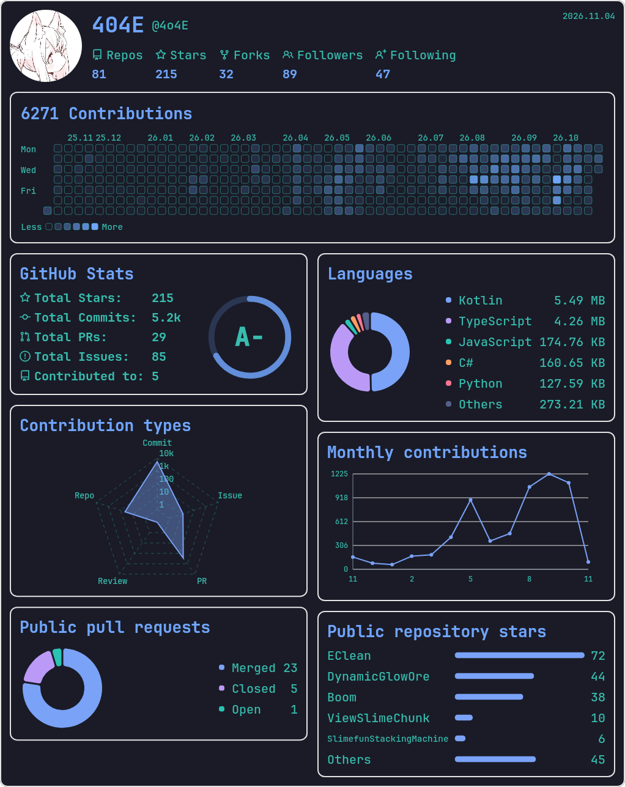
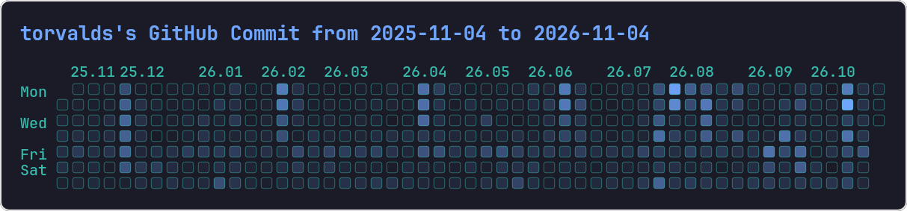
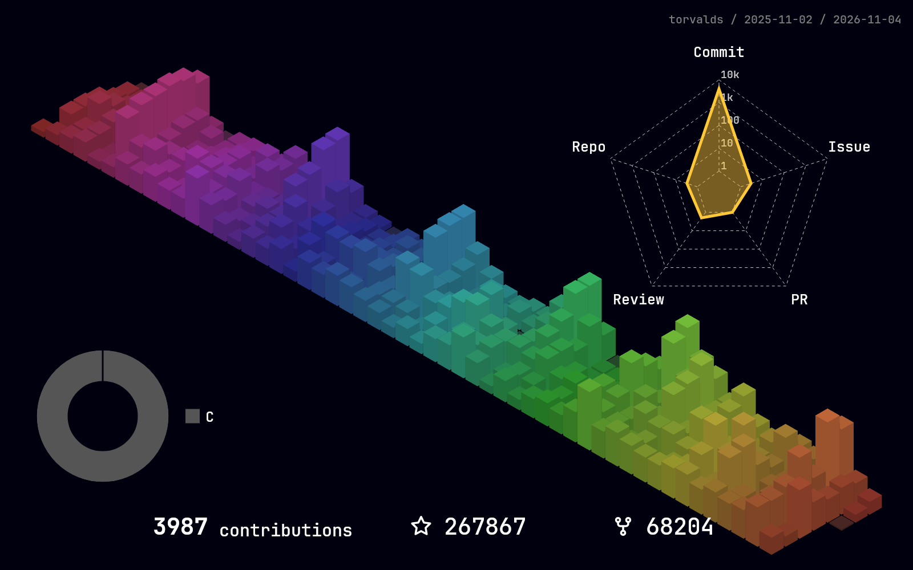
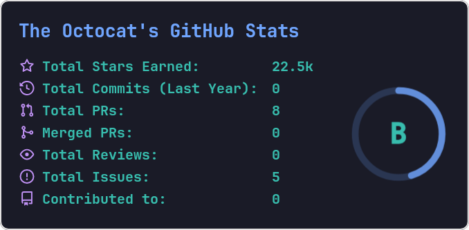
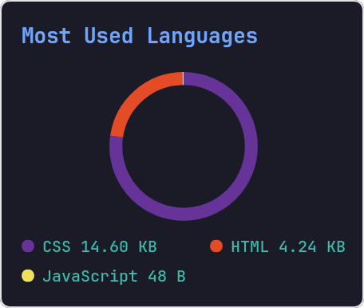
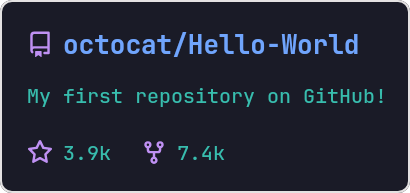
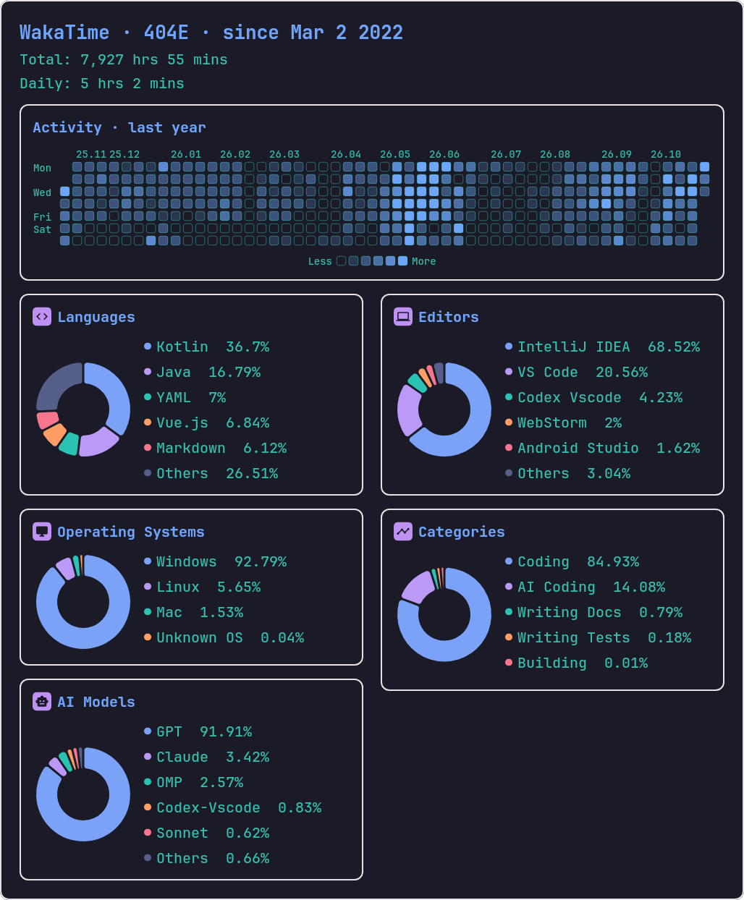

# statimg HTTP API

本文覆盖当前源码的全部 **9 个 GET 接口**：7 个 PNG 接口、2 个主题 JSON 接口。机器可读契约见 [OpenAPI 3.1](openapi.yaml)，部署流程见[项目 README](../README.md)。发行包的行为以对应版本源码为准。

## 约定

### 地址、认证与响应

以下 curl 示例在 Linux／WSL shell 中执行，先设置服务地址：

```sh
export STATIMG_URL=http://localhost:2345
```

Jar 默认端口为 `2345`；仓库 Docker Compose 默认映射宿主机 `80`，沿用该映射时设置 `STATIMG_URL=http://localhost`。示例中的用户名、仓库名和日期均可替换。

- 所有接口均为 `GET`，无请求体，调用方不传入 GitHub／WakaTime 令牌。
- GitHub API 令牌通过服务端 `config.yml` 的 `github_token` 或镜像的 `GITHUB_TOKEN` 配置；WakaTime 只使用匿名公开接口。
- 图片成功响应：`200`、`Content-Type: image/png`，响应体是 PNG 二进制，不是 JSON、SVG 或 Base64。
- 主题成功响应：`200`、`Content-Type: application/json`，响应体是字符串数组。
- 服务没有结果缓存、调用方认证或自身限流；公开部署时由反向代理及调用方负责。GitHub、WakaTime 自身仍有访问限制。
- 综合图会读取多个上游接口及分页，请给请求预留足够的超时。示例使用 `--max-time 300`，不是服务保证的完成时间。
- 图片链接中的文字参数需要 URL 编码；curl 可以使用 `--get --data-urlencode 'custom_title=My GitHub Stats'`。

### 参数解析

| 类型 | 实际行为 |
| --- | --- |
| 布尔参数 | 只有字符串 `true`（大小写不敏感）开启；省略、`false`、`1`、空字符串均为关闭。 |
| CSV 参数 | 使用逗号分隔，去掉每项首尾空白，忽略空项。 |
| 枚举参数 | `layout`、`rank_icon`、`number_format`、`stats_format` 大小写不敏感；未知值采用该参数的默认分支。 |
| 可选数字 | 无法解析为指定数值类型时按未提供处理；可解析但越界的部分显示参数会截断到渲染范围，见各接口说明。 |
| 2D 主题 | `theme` 精确匹配 `themes2d` 名称。省略或未知名称使用内置默认主题，不一定是主题列表的第一项。 |
| 3D 主题 | 仅 `/github/contribution3d/{username}` 使用 `themes3d`；省略或未知名称使用 `rainbow`。两个主题列表接口均**不返回 3D 主题**。 |
| 未支持的参数 | 不参与该接口处理，例如为综合图传入独立卡片的选项不会改变综合图。 |

GitHub 独立 2D 贡献图、评级卡、语言卡和仓库卡使用 2 像素外框；背景与边框的圆角均取服务配置 `layout2d.bg_radii`，新默认值为 12 像素。已有配置中的值不会自动覆盖，如需相同圆角须自行调整。综合图与 3D 图不使用此配置控制外框。

## 接口目录

| 方法 | 路径 | 成功响应 | 示例 |
| --- | --- | --- | --- |
| GET | `/github/dashboard/{username}` | PNG | [图片](examples/github-dashboard.png) |
| GET | `/github/contribution/{username}/{end}` | PNG | [图片](examples/github-contribution.png) |
| GET | `/github/contribution3d/{username}` | PNG | [图片](examples/github-contribution3d.png) |
| GET | `/github/stats/{username}` | PNG | [图片](examples/github-stats.png) |
| GET | `/github/top-langs/{username}` | PNG | [图片](examples/github-top-langs.png) |
| GET | `/github/repo/{owner}/{repo}` | PNG | [图片](examples/github-repo.png) |
| GET | `/wakatime/stats/{username}` | PNG | [图片](examples/wakatime-stats.png) |
| GET | `/github/themes` | JSON 字符串数组 | [实际 JSON](examples/github-themes.json) |
| GET | `/wakatime/themes` | JSON 字符串数组 | [实际 JSON](examples/wakatime-themes.json) |

## GitHub 综合统计图

```http
GET /github/dashboard/{username}
```

将头像与用户概览、贡献日历、评级统计、语言、五类贡献雷达图、月度趋势、公开 PR 状态和仓库 Stars 合并为单张瀑布流 PNG。

| 位置 | 参数 | 类型 | 必填 | 默认／说明 |
| --- | --- | --- | --- | --- |
| path | `username` | string | 是 | GitHub 用户名。 |
| query | `theme` | string | 否 | `themes2d` 主题；未提供或未命中时使用内置默认主题。 |

**数据范围：**

- 仓库／Stars／Forks：用户拥有的全部公开仓库，包含 Fork，读取完整仓库分页。
- 语言：公开非 Fork 仓库的语言字节量，读取仓库及语言的完整分页；前五项以外合并为 `Others`。
- 热力图、`Contributions` 和月度趋势：共用匿名读取的 GitHub 用户主页贡献日历，采用页面声明的滚动年度范围、tooltip 精确每日次数，遵循目标用户的公开贡献设置，包括用户选择公开展示的受限贡献。页面结构或数据校验失败时请求失败，不回退到 GraphQL 日历。
- 年度 Commits 与五类贡献：使用 GitHub `contributionsCollection`，请求范围为本次请求向前 365 天。雷达图只显示 Commit、Issue、PR、Review、Repo，不增加 Private 类别；不会取得其他用户私有仓库明细。
- PR／Issue：作者为该用户的公开条目。PR 的 Merged、Open、Closed（未合并）互不重叠；Search API 结果不完整时请求失败，不输出部分统计。
- `Contributed to`：GitHub 返回的近期参与公开仓库数量，不是历史累计参与数。
- 评级复用独立统计卡的算法，不是 GitHub 官方评级。

右上角是生成当天日期（Asia/Taipei，`yyyy.MM.dd`），不表示所有卡片拥有相同统计区间。各独立数据请求并发获取，游标分页按依赖顺序读取，数据齐备后统一绘制。

雷达图零值位于圆心，全零时显示单个数据色圆心点；正数对应 `1／10／100／1k／10k` 五层网格，超过 10k 停在外圈。月度趋势只显示水平参考网格。布局以日历自然宽度为基准，下方双列瀑布流；环形图在左、数值图例在右。

**实际请求与图片：**

```sh
curl -fS --max-time 300 "$STATIMG_URL/github/dashboard/4o4E?theme=tokyonight" -o github-dashboard.png
```



## GitHub 2D 贡献热力图

```http
GET /github/contribution/{username}/{end}
```

独立的贡献日历 PNG，使用 GitHub GraphQL 贡献数据，**不是** Dashboard 使用的匿名主页日历。

| 位置 | 参数 | 类型 | 必填 | 默认／说明 |
| --- | --- | --- | --- | --- |
| path | `username` | string | 是 | GitHub 用户名。 |
| path | `end` | string(date) | 是 | `yyyy-MM-dd`。查询截止到该日期的 `00:00`，起点为其前一年；不是截止日的 `23:59:59`。 |
| query | `theme` | string | 否 | `themes2d` 主题；默认内置主题。 |

无效日期返回 `400`，文本以 `invalid end date:` 开头；上游查询或绘制失败也返回 `400`。

**实际请求与图片：**

```sh
curl -fS --max-time 300 "$STATIMG_URL/github/contribution/torvalds/2026-11-04?theme=tokyonight" -o github-contribution.png
```



## GitHub 3D 贡献图

```http
GET /github/contribution3d/{username}
```

返回 3D 贡献柱图、提交语言环形图、五类贡献雷达图及贡献／Stars／Forks 汇总。贡献日历采用 GitHub GraphQL 默认贡献区间，不支持通过请求指定起止时间。Stars／Forks 汇总最多读取 100 个用户所属仓库；提交语言来自贡献仓库的主要语言，并非语言字节量。

| 位置 | 参数 | 类型 | 必填 | 默认／说明 |
| --- | --- | --- | --- | --- |
| path | `username` | string | 是 | GitHub 用户名。 |
| query | `theme` | string | 否 | `themes3d` 主题，默认 `rainbow`。未知名称也使用 `rainbow`，不是 2D 主题。 |

服务配置须保留 `themes3d.rainbow`；可用 3D 主题以服务配置为准。失败返回 `400`。

**实际请求与图片：**

```sh
curl -fS --max-time 300 "$STATIMG_URL/github/contribution3d/torvalds?theme=rainbow" -o github-contribution3d.png
```



## GitHub 评级统计卡

```http
GET /github/stats/{username}
```

独立的统计与评级 PNG，不会采用 Dashboard 的瀑布流布局。

| 位置 | 参数 | 类型 | 必填 | 默认／说明 |
| --- | --- | --- | --- | --- |
| path | `username` | string | 是 | GitHub 用户名。 |
| query | `theme` | string | 否 | `themes2d` 主题；默认内置主题。 |
| query | `hide` | CSV string | 否 | 隐藏指标，默认空；名称见下表。 |
| query | `show` | CSV string | 否 | 开启可选指标，默认空；名称见下表。 |
| query | `show_icons` | boolean | 否 | 默认 `false`，显示各指标图标。 |
| query | `hide_rank` | boolean | 否 | 默认 `false`，隐藏评级圆环。 |
| query | `include_all_commits` | boolean | 否 | 默认 `false`。启用时用 Search API 的 `author:username` 总提交数替换贡献提交数；不受 `commits_year` 和 `exclude_repo` 过滤，搜索结果为 0 或缺失时当前实现返回 `400`。 |
| query | `commits_year` | integer | 否 | 默认不指定。设置 GraphQL 提交贡献查询起点为该年 `01-01T00:00:00Z`，不设置结束点；不是任意历史整年的查询。`include_all_commits=true` 时显示的提交数来自 Search，不使用此年份过滤。 |
| query | `exclude_repo` | CSV string | 否 | 从 Stars 汇总中排除的仓库短名称，如 `repo-a,repo-b`；默认空。与服务环境变量 `EXCLUDE_REPO` 合并。 |
| query | `rank_icon` | string | 否 | `default` 显示等级，`percentile` 显示 Top 百分比；默认 `default`。 |
| query | `number_format` | string | 否 | `short` 使用 k／M／B，`long` 显示完整数值；默认 `short`。 |
| query | `number_precision` | integer | 否 | 缩写数值的小数位数，默认 `1`，截断到 `0..2`；小于 1000 的数值及完整格式有各自固定格式。 |
| query | `custom_title` | string | 否 | 替换默认卡片标题。 |

| 指标 ID | 默认显示 | 含义 |
| --- | --- | --- |
| `stars` | 是 | 用户所属仓库获得的 Stars。 |
| `commits` | 是 | 提交贡献数，默认 GitHub 近一年贡献区间。 |
| `prs` | 是 | PR 总数。 |
| `issues` | 是 | Open 与 Closed Issue 数之和。 |
| `contribs` | 是 | GitHub 返回的近期参与仓库数。 |
| `reviews` | 否 | Review 贡献数。 |
| `prs_merged` | 否 | 已合并 PR 数。 |
| `prs_merged_percentage` | 否 | 已合并 PR 占全部 PR 的百分比。 |
| `discussions_started` | 否 | 发起的 Discussion 数。 |
| `discussions_answered` | 否 | 被标为答案的 Discussion 回复数。 |

`show` 用于开启表中的可选指标，`hide` 可隐藏任一已显示指标；二者的 ID 大小写敏感，`hide` 优先。隐藏指标只影响显示，不会从评级计算中去掉该指标。

**边界：**该独立接口的 Stars 只汇总按 Stars 降序排列的前 100 个用户所属仓库，不保证是账号所有仓库的合计；提交、Review、PR／Issue、参与仓库数各有自己的区间。与完整公开分页的 Dashboard 不同，独立接口数据受当前 GitHub API 查询和令牌可见范围影响。参数或上游查询失败返回 `400`，GitHub 也可能拒绝超出允许长度的贡献日期区间。

**实际请求与图片：**

```sh
curl -fS --max-time 300 "$STATIMG_URL/github/stats/octocat?theme=tokyonight&show_icons=true&show=reviews,prs_merged" -o github-stats.png
```



## GitHub 语言卡

```http
GET /github/top-langs/{username}
```

按语言字节量与仓库出现次数聚合的语言分布 PNG，**不代表编码时长**。当前独立接口最多读取用户所属的 100 个非 Fork 仓库、每仓库前 10 种语言；不是 Dashboard 的完整分页语言统计。

| 位置 | 参数 | 类型 | 必填 | 默认／说明 |
| --- | --- | --- | --- | --- |
| path | `username` | string | 是 | GitHub 用户名。 |
| query | `theme` | string | 否 | `themes2d` 主题；默认内置主题。 |
| query | `layout` | string | 否 | `normal`、`compact`、`donut`、`donut-vertical`（或 `donut_vertical`）、`pie`；默认 `normal`。 |
| query | `langs_count` | integer | 否 | 最多显示的语言数量，截断到 `1..20`。默认 `normal`／`donut` 为 `5`，其余布局为 `6`；开启 `hide_progress` 时默认也为 `6`。 |
| query | `hide` | CSV string | 否 | 要隐藏的语言名称，默认空，匹配时忽略大小写。 |
| query | `hide_progress` | boolean | 否 | 默认 `false`。隐藏进度条；`normal` 布局会使用紧凑图例形式。 |
| query | `exclude_repo` | CSV string | 否 | 排除的仓库短名称，默认空，与服务环境变量 `EXCLUDE_REPO` 合并。 |
| query | `size_weight` | number | 否 | 字节量指数，默认 `1.0`；无法解析时使用默认值。 |
| query | `count_weight` | number | 否 | 语言出现仓库数指数，默认 `0.0`；无法解析时使用默认值。 |
| query | `stats_format` | string | 否 | `percentages` 或 `bytes`，默认 `percentages`。 |
| query | `custom_title` | string | 否 | 替换默认卡片标题。 |

语言权重为 `字节量 ^ size_weight × 出现仓库数 ^ count_weight`。`stats_format=bytes` 显示的是加权后的值；只有使用默认权重时才能直接按实际聚合字节量理解。单位为 B／KB／MB／GB。

`langs_count` 之外的语言不显示，不会在此独立接口中汇总为 `Others`。请求或绘制失败返回 `400`。

**实际请求与图片：**

```sh
curl -fS --max-time 300 "$STATIMG_URL/github/top-langs/octocat?theme=tokyonight&layout=donut-vertical&langs_count=6&stats_format=bytes" -o github-top-langs.png
```



## GitHub 仓库卡

```http
GET /github/repo/{owner}/{repo}
```

返回仓库名、描述、主要语言、Stars、Forks 等信息的 PNG。

| 位置 | 参数 | 类型 | 必填 | 默认／说明 |
| --- | --- | --- | --- | --- |
| path | `owner` | string | 是 | 仓库所有者，用户或组织名称。 |
| path | `repo` | string | 是 | 仓库短名称，不包含所有者和 `.git` 后缀。 |
| query | `theme` | string | 否 | `themes2d` 主题；默认内置主题。 |
| query | `show_owner` | boolean | 否 | 默认 `false`，开启后标题显示 `owner/repo`。 |
| query | `description_lines_count` | integer | 否 | 描述最多显示行数，默认 `3`，截断到 `1..3`。 |

仓库卡仅支持公开仓库；即使服务端令牌可读取私有仓库，也不会渲染该仓库。找不到仓库、私有仓库、当前令牌不可见或绘制失败均返回 `400`，不是 `404`。

**实际请求与图片：**

```sh
curl -fS --max-time 300 "$STATIMG_URL/github/repo/octocat/Hello-World?theme=tokyonight&show_owner=true&description_lines_count=2" -o github-repo.png
```



## WakaTime 综合统计图

```http
GET /wakatime/stats/{username}
```

仅通过匿名公开接口获取数据，将活动热力图、语言、编辑器、操作系统、活动分类、AI 模型合并为单张 PNG；**不使用 WakaTime 个人令牌、App token 或 Secret API Key**。

| 位置 | 参数 | 类型 | 必填 | 默认／说明 |
| --- | --- | --- | --- | --- |
| path | `username` | string | 是 | WakaTime 用户标识，例如 `404E`。 |
| query | `theme` | string | 否 | `themes2d` 主题；默认内置主题。 |

- 在 [WakaTime Profile 设置](https://wakatime.com/settings/profile) 中开启希望展示的数据。各类别的公开开关独立，未公开的类别不绘制。
- 分类统计直接使用用户设置的公开范围，范围放在标题中。此接口不提供 `range` 参数，传入其他时间范围不会改变结果。
- `Total`、`Daily` 只在编码时长公开时显示；未公开时长不会推算时长。
- 每个公开分组展示占比前五项，其余合并为 `Others`，采用圆角环形图和双列瀑布流。
- 活动日历来自 WakaTime 首页使用的 `/insights/days/public`，使用其独立的年度范围。分档值不是精确时长，不累加为时长，也不将分类统计的 `all time` 当作日历范围。
- 只有日历公开或只有分类公开时仍可生成图片；没有可展示的公开数据时返回 `403 wakatime_public_data_unavailable`。不存在的用户返回 `404 wakatime_user_not_found`。

**实际请求与图片：**

```sh
curl -fS --max-time 300 "$STATIMG_URL/wakatime/stats/404E?theme=tokyonight" -o wakatime-stats.png
```



## GitHub 主题列表

```http
GET /github/themes
```

无参数。返回当前服务 `themes2d` 中全部键的 JSON 字符串数组，没有包装对象，不包含 3D 主题。列表取决于服务配置，不能将文档快照当作固定枚举。

```sh
curl -fS "$STATIMG_URL/github/themes" -o github-themes.json
```

[查看本次真实响应 JSON](examples/github-themes.json)。这是 JSON 接口，不生成图片。

## WakaTime 主题列表

```http
GET /wakatime/themes
```

无参数。返回当前服务 `themes2d` 中全部键的 JSON 字符串数组，与 GitHub 主题列表使用同一配置，不包含 3D 主题。

```sh
curl -fS "$STATIMG_URL/wakatime/themes" -o wakatime-themes.json
```

[查看本次真实响应 JSON](examples/wakatime-themes.json)。这是 JSON 接口，不生成图片。

## 错误处理

| 状态 | 适用接口 | 响应说明 |
| --- | --- | --- |
| `400 Bad Request` | 全部 GitHub PNG 接口 | 日期格式错误、找不到用户／仓库、上游查询失败、权限／限流问题或绘制失败等；`text/plain`，内容为异常消息，不能依赖具体措辞稳定。不是所有参数非法都会触发 `400`，部分参数按前述规则采用默认值或截断。 |
| `403 Forbidden` | WakaTime 综合图 | `text/plain`，精确错误码 `wakatime_public_data_unavailable`。调用方应提示目标用户开启可展示的公开数据。 |
| `404 Not Found` | WakaTime 综合图 | `text/plain`，精确错误码 `wakatime_user_not_found`。不存在的路由也会由 Ktor 返回 `404`，但不使用此业务错误码。 |
| `500 Internal Server Error` | 未被路由捕获的异常 | 例如 WakaTime 的其他上游／解析／绘制异常，由 Ktor 处理；响应体不作为稳定业务契约。不要把它等同于用户未公开数据。 |

WakaTime 未公开数据的响应体：

```text
wakatime_public_data_unavailable
```

需要查看失败状态与文本时使用 `curl -i`；前面的下载示例使用 `-f`，遇到 HTTP 错误会失败，避免将错误文本保存为图片。调用方应先判断状态码和 `Content-Type`，再解码图片。

## 示例来源

图片与 JSON 于 **2026-11-04** 通过实际 HTTP 请求获取，保存在 `docs/examples/`。仓库卡图片由包含当前源码修复的本地服务生成，已发布的 6.0.2 版本不包含该修复。上游数据、公开设置或主题变化后，重新调用的内容会变化；示例不是实时数据。生成示例所用 GitHub 令牌未写入文档、图片请求或仓库。
